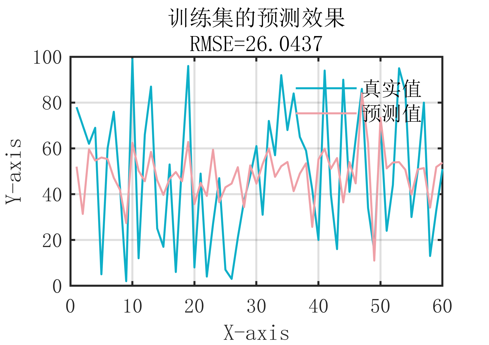
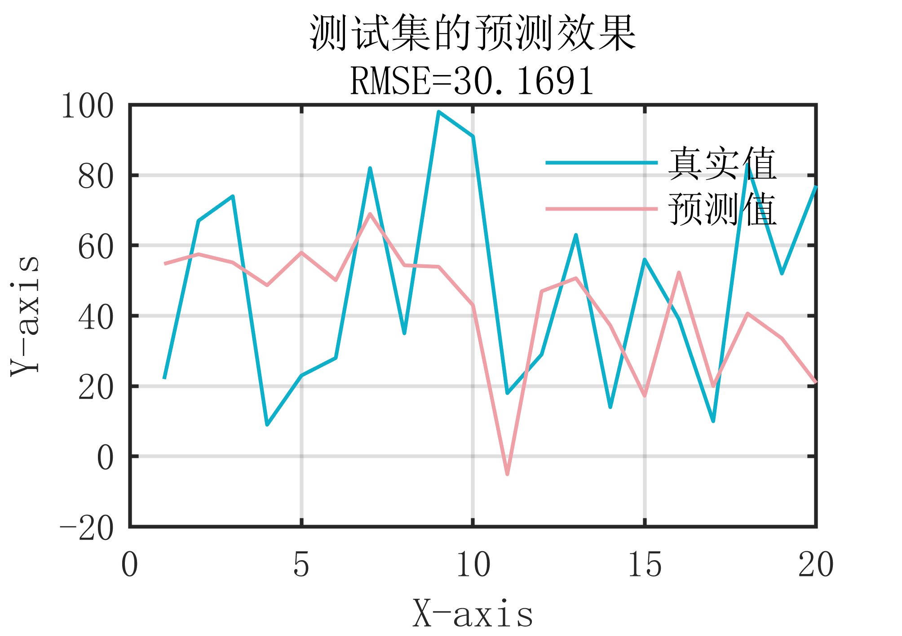

# MATLAB | Regression Prediction | Radial Basis Function (RBF) Radial Basis Neural Network | Attached data and plotting code | Directly for use.

RBF Neural Network (Radial Basis Function Neural Network) is a type of feedforward neural network based on radial basis functions. It features rapid training speed and good generalization performance. The basic structure of an RBF Neural Network includes the input layer, hidden layer, and output layer. The hidden layer is the RBF layer, where the neurons use radial basis functions to calculate the distance between the input vector and each neuron, using this distance value as the activation function for the neuron. Common radial basis functions include Gaussian functions, polynomial functions, etc. RBF Neural Networks are commonly used for solving classification and regression problems. Its training process usually adopts unsupervised learning algorithms such as K-means clustering to initialize the centers of the RBF layers, and then uses supervised learning algorithms like error backpropagation to adjust the network's weights. The advantages of RBF Neural Networks include strong generalization ability, fast training speed, ease of implementation, and adjustment. However, it also has some disadvantages, such as sensitivity to parameter selection and prone to overfitting.
Attached is the diagram:
\n        \n  
\n        \n  
Attached is the video tutorial operation:
\n        \n          \n          \n          \n          \n            To view this video please enable JavaScript, and consider upgrading to a\n            web browser that\n            supports HTML5 video

## Images

<!-- PAYMENT_BLOCK -->

## Get this dataset

- Payment link (Stripe): [Buy now](https://buy.stripe.com/3cs8yP7sY87d0vu9AB)
- Payment QR code: 

<!-- /PAYMENT_BLOCK -->
